# be-mused

Your desk requires a little more Tayne.

Tayne, Celery Man, Oyster, and Eggman as animated companions for [Muse](https://github.com/facebookincubator/muse-gadget-sdk). They move while idle and react while Muse listens and speaks.

Tayne's dances use frames from the sketch, including the low bounce and Flarhgunnstow sequence.
He swings his arms while listening, kicks with his arms raised while thinking, and switches to the sketch's close-up while speaking.

Celery Man uses three dances from the sketch: hip sway while idle, raised-fist shuffle while listening and speaking, and 4d3d3 when happy. Thinking adds dots below his feet.

Oyster also comes straight from the footage. He headbangs while idle, swings his arms back while listening, waves while speaking and when happy, and prints out his own smiling portrait while thinking.

Eggman brings the *I Think You Should Leave* game sketch to Muse, including the front reveal and pants-lowering sequences.

| Tayne | Celery Man | Oyster | Eggman |
| :---: | :---: | :---: | :---: |
|  |  |  |  |

## Tayne’s moves

| Low bounce | Arm swing | Raised-arm kicks | Close-up | Flarhgunnstow |
| :---: | :---: | :---: | :---: | :---: |
|  |  |  |  |  |
| Idle | Listening | Thinking | Speaking | Happy |

## Celery Man’s moves

| Hip sway | Raised-fist shuffle | 4d3d3 |
| :---: | :---: | :---: |
|  |  |  |
| Idle; thinking adds dots | Listening and speaking | Happy |

## Oyster’s moves

| Headbang | Arms back | Greeting | Printout |
| :---: | :---: | :---: | :---: |
|  |  |  |  |
| Idle | Listening | Speaking and happy | Thinking |

## Eggman’s moves

Every pose and movement comes from real frames of the [Eggman game sketch](https://www.youtube.com/watch?v=K0OSfbPJFa4), with the monitor background removed. The original camera motion and brief animation ghosting remain.

| Ready | Listening | Thinking | Speaking |
| :---: | :---: | :---: | :---: |
|  |  |  |  |
| Open-mouth waiting pose | Closed-mouth neutral pose | Turns front to back | Chews and reopens his mouth |

| Startup | Happy | Error | Power off |
| :---: | :---: | :---: | :---: |
|  |  | 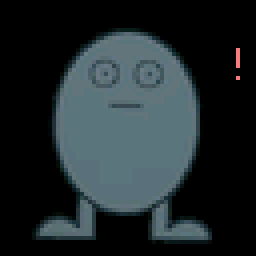 |  |
| Close-up reveal, pull up, hold | Rear-facing crouch gag | Lower pants, hold | Lower pants, fade out |

Ready and Listening hold their source poses. Startup, Error, and Power off play once; the GIFs repeat for comparison. Startup gets 1.8 seconds, and Power off gets 2.2 seconds so the full lowering sequence finishes before the screen fades. Happy is the brief pet/end-of-turn reaction. See [source clips and extraction details](ART.md#eggman).

## Supported devices

Animated display mockups cycle through **Tayne, Celery Man, Oyster, and Eggman**. Each includes Oyster’s printout plus Eggman’s startup reveal, ready pose, and pants-lowering shutdown. Screen proportions and avatar sizes follow Muse’s layouts; cases are simplified and not shown to physical scale.

| M5Stack StickS3 | M5Stack StickC Plus2 | AIPI Lite |
| :---: | :---: | :---: |
| 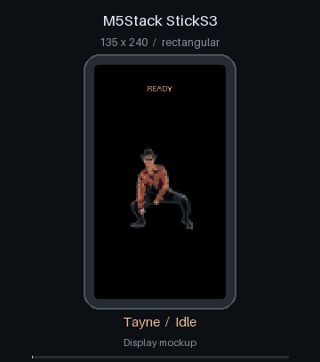 | 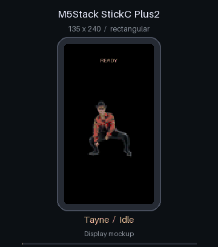 | 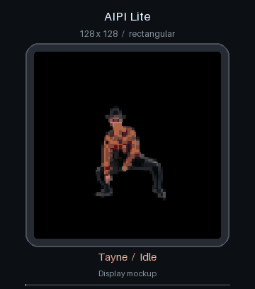 |
| 135×240 · Buttons | 135×240 · Buttons | 128×128 · Buttons |

| SenseCAP Watcher | Waveshare S3 1.75C | Waveshare C6 1.8 |
| :---: | :---: | :---: |
| 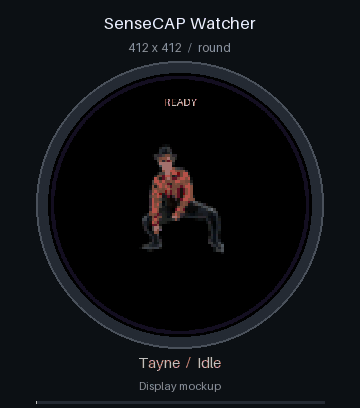 |  | 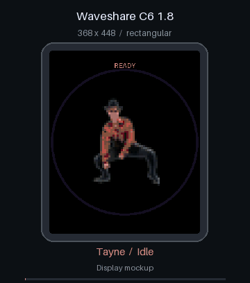 |
| 412×412 · Round Touchscreen | 466×466 · Round Touchscreen | 368×448 · Touchscreen |

| Waveshare S3 1.75 | Waveshare S3 2.16 | Espressif ESP32-S3-BOX-3 |
| :---: | :---: | :---: |
| 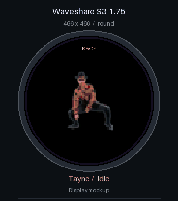 | 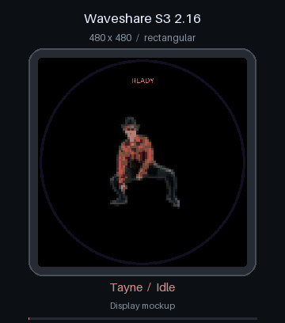 | 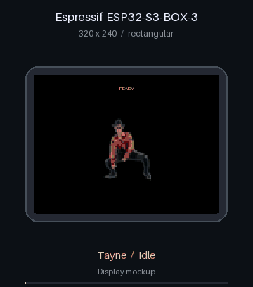 |
| 466×466 · Round Touchscreen | 480×480 · Touchscreen | 320×240 · Touchscreen |

| Waveshare C6 2.06 | M5Stack Cardputer ADV | M5Stack StopWatch |
| :---: | :---: | :---: |
| 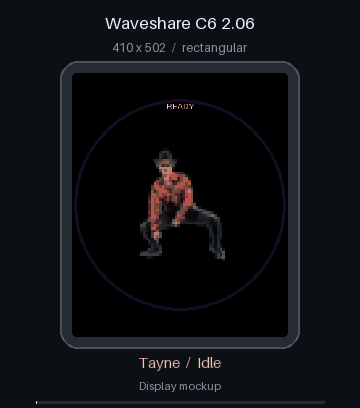 | 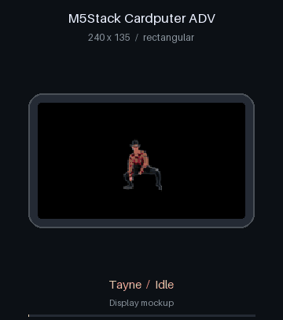 | 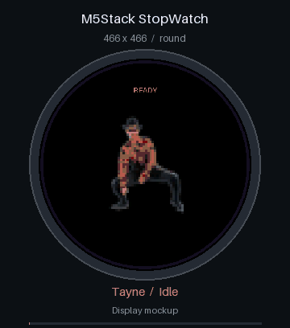 |
| 410×502 · Touchscreen | 240×135 · Keyboard | 466×466 · Round Touchscreen |

| M5Stack CoreS3 | M5Stack Core2 v1.0 | Freenove FNK0104B |
| :---: | :---: | :---: |
| 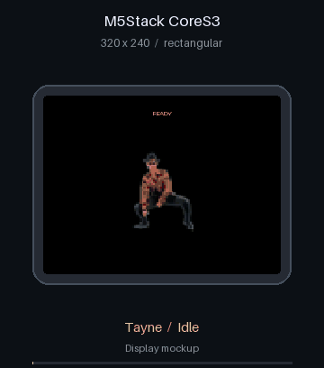 | 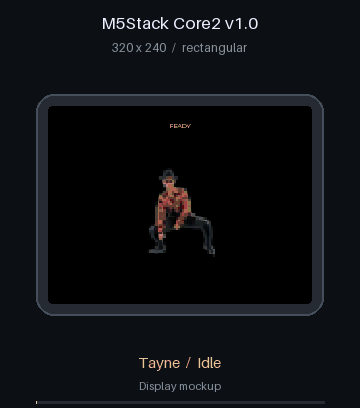 |  |
| 320×240 · Touchscreen | 320×240 · Touchscreen | 240×320 · Touchscreen |

| Guition JC3248W535 | Waveshare S3 LCD 7 | VN ESP32-S3 1.83 |
| :---: | :---: | :---: |
| 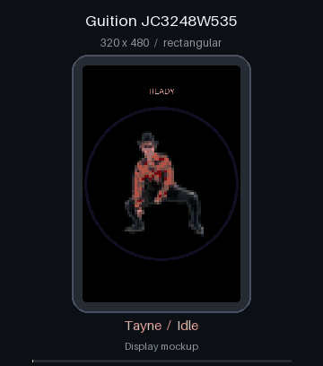 | 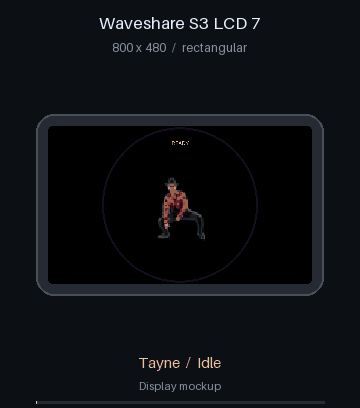 | 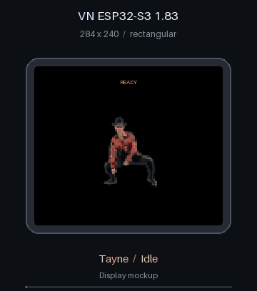 |
| 320×480 · Touchscreen | 800×480 · Touchscreen | 284×240 · Buttons |

| FoloToy AI Passport |
| :---: |
| 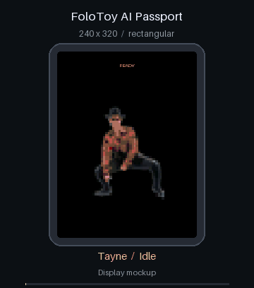 |
| 240×320 · Buttons |

Build profiles include character selection on all listed devices. StickS3 has been tested on hardware with the current SDK; the other boards have build checks only. Cardputer ADV and AI Passport inherit upstream's experimental status. See [devices and screen sizes](DEVICES.md) and [build results](TESTING.md).

## Get started

You'll need a compatible device, a USB data cable, and a Muse account. Start with the [installation guide](INSTALL.md) to build and flash the firmware.

## Choose a character

**Buttons:** open the menu with the side/menu button, choose **Character** with the front/select button, then select a character. Your choice is saved.

**Keyboard:** use Esc to open the menu, Up/Down to move, and Enter to choose. Esc or Left returns without changing the character.

**Touchscreens:** swipe to Settings, open **Character**, and tap a name.

**Pet** restores Muse's original avatar. It is also available as **Default pet** in the character list.

Muse still handles conversations, voice input, and pairing. Replies currently appear as captions. This pack changes the character on screen.

## A few things to know

This is an early project. We’re still investigating intermittent power-related resets on the StickS3. A physical restart has recovered our test device. Details and test results are in [TESTING.md](TESTING.md).

The pack follows a tested Muse SDK revision. See [upstream updates](UPSTREAM.md) for how we stay compatible.

Want to change the art or add a device? See [DEVELOPMENT.md](DEVELOPMENT.md). [ART.md](ART.md) records where every animation comes from in the sketch.

Inspired by [Tim & Eric's Celery Man sketch](https://www.youtube.com/watch?v=a8K6QUPmv8Q), with Eggman from [I Think You Should Leave](https://www.youtube.com/watch?v=K0OSfbPJFa4). An unofficial fan project. Code is [Apache-2.0](LICENSE); that license does not grant rights to the original characters, likenesses, or trademarks. See [credits](NOTICE).
